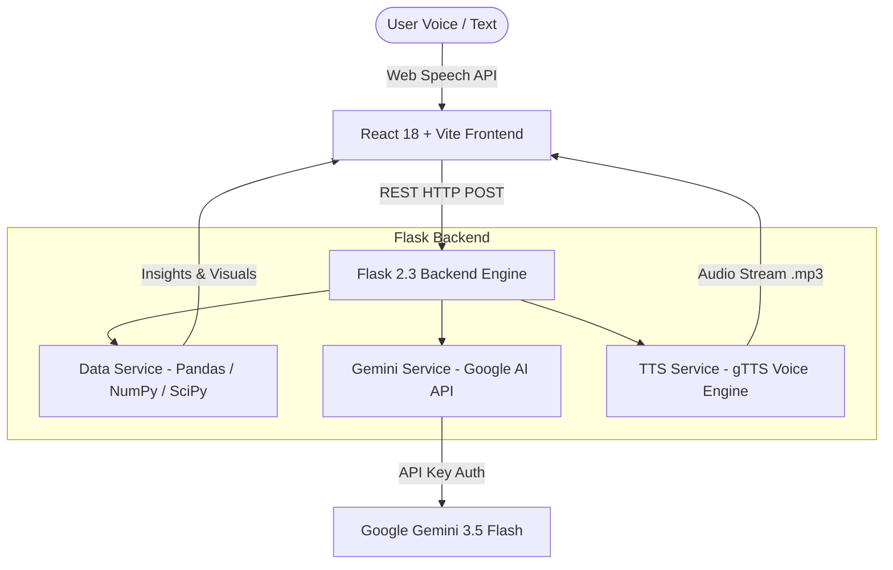

# Vocalis AI — Voice-Powered Data Intelligence Platform

<div align="center">

[](https://reactjs.org/)
[](https://vitejs.dev/)
[](https://tailwindcss.com/)
[](https://flask.palletsprojects.com/)
[](https://python.org/)
[](https://ai.google.dev/)

**Vocalis AI** is an enterprise-grade, voice-driven data intelligence & conversational analytics platform. Speak directly to your tabular data (CSV/Excel), perform dynamic statistical analysis, render interactive visualizations, and receive instant AI voice synthesis.

[Key Features](#-key-features) • [System Architecture](#-system-architecture) • [Quick Start](#-quick-start) • [API Reference](#-api-reference) • [Documentation](#-documentation)

</div>

---

## 🎯 Key Features

### 🎙️ Hands-Free Voice Intelligence
* **Web Speech Recognition**: Speak naturally to query dataset properties, request correlations, or identify anomalies.
* **Text-to-Speech (TTS) Voice Synthesis**: Hear natural-language insights generated directly by backend gTTS / PyTTSx3 engines.
* **Interactive Voice Visualizer**: Animated radial sound waves and status indicators reflecting AI thinking states.

### 📊 Comprehensive Data Analytics Suite
* **Multi-Format Ingestion**: Upload CSV and Excel (`.xlsx`, `.xls`) files up to 50MB.
* **Descriptive Statistics**: Automated calculations of Mean, Median, Std Dev, Interquartile Range (IQR), and Range.
* **Field Quality & Completeness**: Live detection of missing values, field types, schema properties, and dataset health warnings.
* **Pearson Correlation Matrix**: Interactive heatmap analyzing relationships between numerical parameters.
* **Dynamic Recharts Data Visualizations**: Bar charts, line charts, scatter plots, and area plots created on demand.

### 🧠 Gemini-Powered Conversational AI
* **Zero-Configuration Model Selection**: Powered by Google's `gemini-3.5-flash-lite` with automatic fallback logic across Flash models.
* **Context Preservation**: Maintains complete conversation history and dataset context across all messages.
* **Deterministic Structured Responses**: High-speed JSON parsing for query interpretation and chart generation.

### 🎨 Modern Glassmorphism UI
* **Custom Glass Styling**: Built using Tailwind CSS, custom blur filters, glowing gradients, and CSS grid layouts.
* **Google Typography**: Styled with `Outfit` (headings) and `Inter` (UI elements).
* **Framer Motion Animations**: Smooth page transitions, tab switches, and hover effects.

---

## 🏗️ System Architecture



---

## 🚀 Quick Start

### Prerequisites
* **Node.js**: v18.0.0 or higher
* **Python**: 3.11 or higher
* **Google Gemini API Key**: Obtain a free API key from [Google AI Studio](https://aistudio.google.com/app/apikey)

---

### Local Development Setup

#### 1. Repository Setup
```bash
git clone https://github.com/charan22640/voice-ai-data-analyst.git
cd voice-ai-data-analyst
```

#### 2. Backend Environment Configuration
```bash
cd backend

# Create & activate virtual environment
python -m venv venv
# On Windows:
venv\Scripts\activate
# On Linux/macOS:
source venv/bin/activate

# Install Python dependencies
pip install -r requirements.txt
```

Create a `.env` file inside `backend/`:
```env
GEMINI_API_KEY=yaha-apna_gemini_ka_api_key_add_karo
FLASK_DEBUG=True
PORT=5000
CORS_ORIGINS=http://localhost:3000,http://localhost:5173
```

#### 3. Frontend Setup
```bash
cd ../frontend

# Install Node modules
npm install
```

Create a `.env.local` file inside `frontend/`:
```env
VITE_API_URL=http://localhost:5000
```

#### 4. Run Application
```bash
# Terminal 1: Launch Backend API Server
cd backend
python app.py

# Terminal 2: Launch Frontend Development Server
cd frontend
npm run dev
```

Open your browser at `http://localhost:5173` or `http://localhost:3000`.

---

### 🐳 Docker Container Deployment

You can run the entire Vocalis AI stack using Docker Compose:

```bash
# 1. Provide your Gemini API key in backend/.env
echo "GEMINI_API_KEY=your_gemini_api_key_here" > backend/.env

# 2. Build and run containers
docker-compose up --build
```

---

## 📖 Usage Guide

1. **Upload Dataset**: Drag & drop any CSV/Excel file or choose one of the pre-loaded demo datasets (*Sales Data*, *Employee Data*, *Web Traffic*).
2. **Explore Insights**:
   - **Overview**: Inspect record count, total fields, missing values, and raw sample data.
   - **Data Quality**: Review column completeness percentages and type detection.
   - **Visualizer**: Render dynamic charts powered by Recharts.
   - **Correlation Matrix**: View Pearson correlation scores with color-coded badges.
   - **Statistical Insights**: Analyze mean, std dev, median, range, and IQR.
3. **Voice Querying**:
   - Click the **Microphone Button** (or press `Space`).
   - Ask a question like: *"What is the revenue trend over time?"* or *"Are there missing values in employee salaries?"*
   - Listen to Vocalis AI speak back the key insights while displaying formatted Markdown text and chart options.

---

## 📡 API Reference

### AI Endpoints (`/api/ai`)

| Method | Endpoint | Description | Payload Example |
| :--- | :--- | :--- | :--- |
| `POST` | `/api/ai/chat` | Send prompt to Gemini AI assistant | `{"message": "Summarize dataset", "context": "..."}` |
| `POST` | `/api/ai/tts` | Synthesize voice audio (.mp3) | `{"text": "Total revenue is $50,000"}` |
| `GET` | `/api/ai/status` | Check Gemini API connection health | N/A |

### Data Endpoints (`/api/data`)

| Method | Endpoint | Description | Payload Example |
| :--- | :--- | :--- | :--- |
| `POST` | `/api/data/upload` | Upload CSV/XLSX file | `multipart/form-data` with `file` |
| `POST` | `/api/data/query` | Perform natural language data query | `{"query": "Show revenue by region"}` |
| `GET` | `/api/data/info` | Retrieve active dataset schema & stats | N/A |
| `GET` | `/api/data/insights` | Automated insights generation | N/A |

---

## 🛠️ Project Directory Structure

```
voice-ai-data-analyst/
├── backend/
│   ├── app.py                      # Flask Application Entry Point
│   ├── routes/
│   │   ├── ai.py                   # AI & Voice Routes
│   │   └── data.py                 # Data Processing Routes
│   ├── services/
│   │   ├── gemini_service.py       # Google Gemini 3.5 AI Integration
│   │   ├── data_service.py         # Pandas/SciPy Engine
│   │   └── tts_service.py          # gTTS Voice Synthesis Engine
│   └── requirements.txt            # Python Dependencies
├── frontend/
│   ├── src/
│   │   ├── components/             # Glassmorphism React UI Components
│   │   ├── index.css               # Styling System & Custom Glass Tokens
│   │   └── App.jsx                 # Application Entry Layout
│   ├── tailwind.config.js          # Tailwind Theme & Color Setup
│   └── package.json                # Frontend Dependencies
└── docker-compose.yml              # Docker Multi-Container Configuration
```

---

## 📝 Troubleshooting & FAQ

<details>
<summary><b>1. Error: "API key not valid. Please pass a valid API key."</b></summary>
Ensure your <code>GEMINI_API_KEY</code> is correctly set inside <code>backend/.env</code> and restart <code>python app.py</code>. Refer to <a href="API_SETUP.md">API_SETUP.md</a> for step-by-step instructions.
</details>

<details>
<summary><b>2. 500 Internal Server Error on File Upload</b></summary>
Ensure required numerical libraries (<code>numpy==1.26.4</code>, <code>openpyxl>=3.1.5</code>, <code>pandas</code>) are installed in your Python environment.
</details>

<details>
<summary><b>3. Microphone Access / Web Speech API Issues</b></summary>
Web Speech API requires HTTPS or <code>localhost</code> / <code>127.0.0.1</code> in Google Chrome or Microsoft Edge.
</details>

---

## 📄 License

Distributed under the MIT License. See `LICENSE` for more information.
